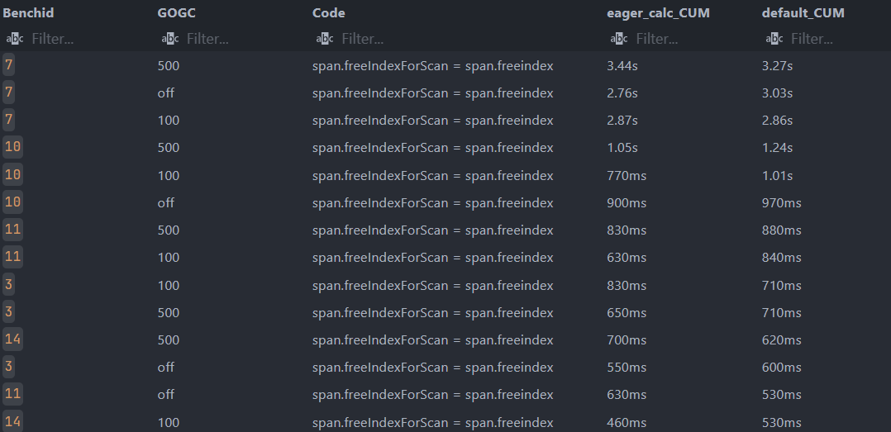
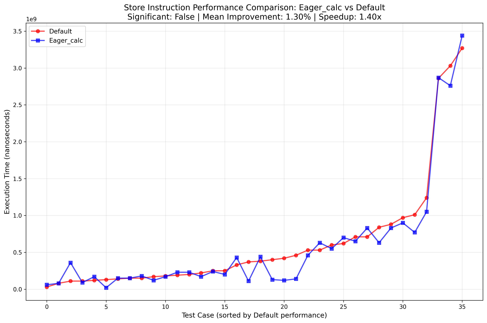

# protoactor-go benchmark for mallocgc

通过 `go test -a -tags=<eager_calc/default/nodmb/nops_mask> -bench=^$BenchName$ -run=^$ -cpuprofile` 执行 protoactor-go 下的所有Benchmark。然后收集 publicationBarrier 之后的 store 指令 `span.freeIndexForScan = span.freeindex` 的时间。

由于Go Runtime的默认采样单位时间是10ms，因此采样计算得到的时间比较大代表采样的次数比较多。如果时间较小，那么受运气影响较大。

按照默认配置 (default) 对屏障后store指令的执行时间降序排序。得到的结果如下：



eager_calc优化配置相比于default的优化并不稳定，有些情况有时间减少。大于1s的累计时间则代表采样到的次数大于100次，相对可靠。

然后对eager_calc和default配置做了配对t检验，结果如下
p值=0.06大于0.05，表示差异是有随机波动导致的。
t值=-1.92，但是在大样本下|t| > 2.05才认为差异显著。
另外d值是0.3252，属于0.2 ≤ |d| < 0.5（小效应）：改进微小，仅在精度要求极高的场景有意义。

以上只是store指令执行时间优化之后的结果，如果从整体上来看，则优化收益更小。

```
Number of data points: 36

Default - Mean: 628888888.89 ns, Std: 790301552.07 ns
Eager_calc - Mean: 585000000.00 ns, Std: 789569151.15 ns

Paired t-test:
t-statistic: -1.9240
p-value: 0.062519
Cohen's d (effect size): 0.3252
Result: Not statistically significant (p >= 0.05)

Performance Improvement:
Mean improvement: 1.30%
Median improvement: 5.62%
Mean speedup ratio: 1.40x

=== Detailed Performance Summary ===
 Benchid GOGC default_CUM eager_calc_CUM  improvement_percentage  speedup_ratio
      12  100       130ms           20ms                   84.62           6.50
       2  off       420ms          120ms                   71.43           3.50
       1  500       370ms          110ms                   70.27           3.36
       1  off       460ms          140ms                   69.57           3.29
       2  500       400ms          130ms                   67.50           3.08
       9  500       170ms          120ms                   29.41           1.42
      11  100       840ms          630ms                   25.00           1.33
      10  100       1.01s          770ms                   23.76           1.31
       2  100       220ms          170ms                   22.73           1.29
       9  100       250ms          200ms                   20.00           1.25
       8  off       110ms           90ms                   18.18           1.22
      10  500       1.24s          1.05s                   15.32           1.18
      14  100       530ms          460ms                   13.21           1.15
       7  off       3.03s          2.76s                    8.91           1.10
       3  500       710ms          650ms                    8.45           1.09
       3  off       600ms          550ms                    8.33           1.09
      10  off       970ms          900ms                    7.22           1.08
      11  500       880ms          830ms                    5.68           1.06
       8  500       180ms          170ms                    5.56           1.06
      13  off       250ms          240ms                    4.00           1.04
      12  500        80ms           80ms                    0.00           1.00
       6  500       150ms          150ms                    0.00           1.00
       7  100       2.86s          2.87s                   -0.35           1.00
       7  500       3.27s          3.44s                   -5.20           0.95
      14  off       140ms          150ms                   -7.14           0.93
      14  500       620ms          700ms                  -12.90           0.89
      13  500       200ms          230ms                  -15.00           0.87
      13  100       380ms          440ms                  -15.79           0.86
       3  100       710ms          830ms                  -16.90           0.86
      11  off       530ms          630ms                  -18.87           0.84
       6  100       150ms          180ms                  -20.00           0.83
       8  100       190ms          230ms                  -21.05           0.83
       9  off       330ms          430ms                  -30.30           0.77
       1  100       120ms          170ms                  -41.67           0.71
      12  off        30ms           60ms                 -100.00           0.50
       6  off       110ms          360ms                 -227.27           0.31
```

执行时间对比图:



