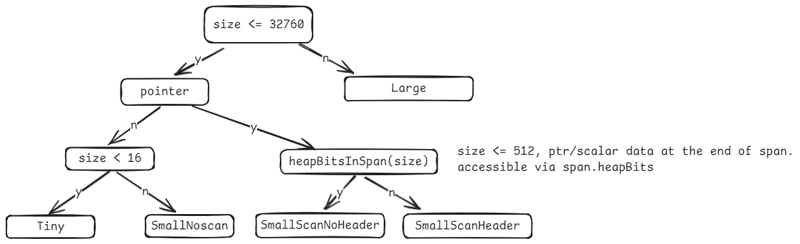
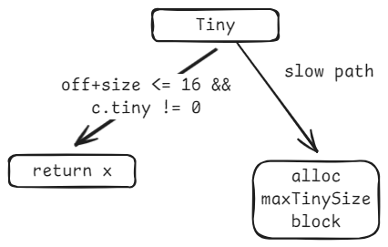
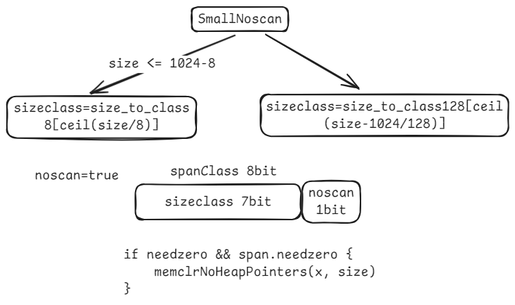
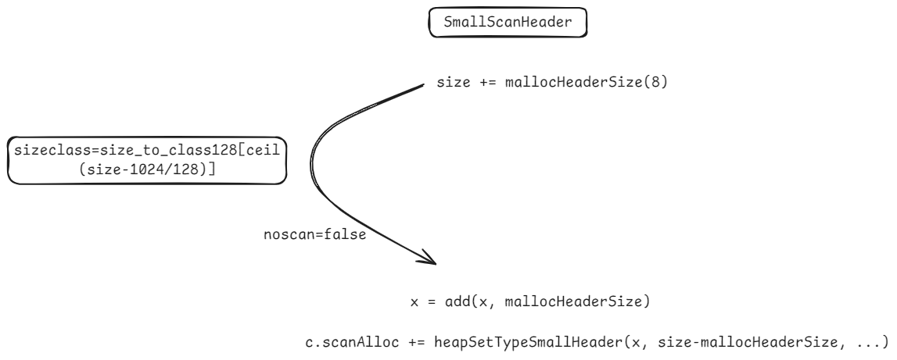
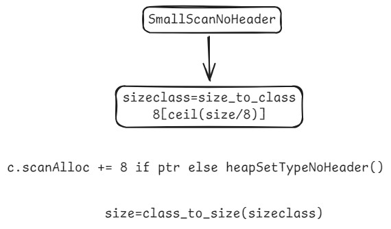
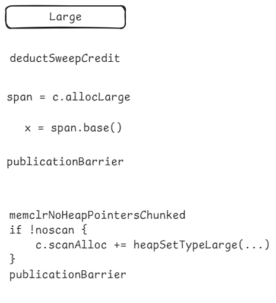

# mallocgc

`mallocgc`的逻辑，会针对不同的malloc size调用更细粒度的不同分配处理函数，其分支逻辑如下图所示：



分配函数总共分为5类：Tiny, SmallNoscan, SmallScanNoHeader, SmallScanHeader, Large

其中:
- Tiny: size < maxTinySize (16 bytes) 且对象不包含指针(typ == nil || !typ.Pointers())
- SmallNoscan: size <= maxSmallSize (32kB) 且对象不包含指针(typ == nil || !typ.Pointers()) 且 size >= maxTinySize
- SmallScanNoHeader: size <= maxSmallSize (32kB) 且对象包含指针(typ != nil && typ.Pointers()) 且 heapBitsInSpan(size) 为 true
- SmallScanHeader: size <= maxSmallSize (32kB) 且对象包含指针(typ != nil && typ.Pointers()) 且 heapBitsInSpan(size) 为 false
- Large: size > maxSmallSize (32kB)

每个分配函数之后都会有 `publicationBarrier` 屏障函数调用。屏障函数内部针对不同平台做了不同的实现。对于x86平台来说，由于x86平台采用了Total Store Order(TSO)内存模型，store指令之间相互有序，因此不需要在将对象零初始化以及通知GC当前空闲的内存分配slot之间添加同步指令，`publicationBarrier`函数实现为只有一条 return 指令。而对于 aarch64 这种弱内存序模型，store 指令之间可能会乱序执行，此时就通过 `DMB ST` 屏障指令保证不同 store 指令之间保证按照程序序提交。

不同分配函数在屏障之前的逻辑如下所示：

Tiny:



SmallNoscan



SmallScanHeader



SmallScanNoHeader



Large



## mp.mallocing

`mp.mallocing`的设置总是和`acquirem`, `releasem`成对出现。

除了`malloc.go`修改`mp.mallocing`外，mutator还包括：
1. `mheap.go` `scavengeAll`, 会执行`gp.m.mallocing++`
2. `panic.go` `startpanic_m` 在一个unrecoverable panic中不允许malloc，会执行`gp.m.mallocing++`，不会再减。
3. `proc.go` `sigprof` 处理SIGPROF信号时，会调用 `getg().m.mallocing++`，由于profiling和GC并发执行，因此profiling不能分配，所以添加`mallocing`来设置一个陷阱。结束之后就`mallocing--`。
4. `arena.go` `userArenaNextFree`(从`userArenaChunkFree`获取指针前后)和`newUserArenaChunk`(从`mheap_.allocUserArenaChunk`获取指针前后)函数，设置`mp.mallocing`为1和0。

`mp.mallocing`作为条件判断分为5类：
1. malloc deadlock
   1. 主要是在分配函数中，`userArenaNextFree`, `newUserArenaChunk`, malloc函数族，
   2. `iface.go` `itabAdd`。常见的例子是在panicking的时候调用`itabAdd`
2. cgo check, `cgocheck.go` `cgoCheckPtrWrite`，如果正在分配内存，那么会写很多mfixalloc结构体，这些结构体看起来像是非Go内存，提早退出
3. m is not locked
   1. `mgcsweep.go` `ensureSwept`，如果`gp.m.locks == 0`没有加锁，`gp.m.mallocing == 0`, `gp != gp.m.g0`，那么表示当前既没有加锁禁止抢占，也没有正在malloc，而且还不是g0
   2. `mgcsweep.go` `sweep`，和1类似，需要有锁或者正在分配或者get()是g0
4. panic检查
   1. `panic.go` `panicCheck1`, `panicCheck2`如果panic的时候`gp.m.mallocing != 0`，则 `throw(msg)`
   2. `panic.go` `gopanic` panic during malloc
   3. `panic.go` `canpanic`，如果正在malloc，则不能panic，需要throw
5. `canPreemptM`判断mp是否可抢占
   1. 可抢占的条件是 `mp.locks == 0 && mp.mallocing == 0 && mp.preemptoff == "" && mp.p.ptr().status == _Prunning`

所以`mp.mallocing`开启之后会有如下影响：
1. m不可抢占，因此也不会响应STW请求，也不会被抢占。只有在分配结束时，协程才可以被重新抢占。
2. 同一个m不可再次进入分配状态，否则throw

如果要将`mp.mallocing`的范围扩大，那可能会导致处在循环中，如果再涉及到其他并发原语，就可能导致死锁，这时候由于`mp.mallocing`始终为0，导致无法被抢占调度。

所以这又对循环内的语句做了进一步要求。

## deductAssistCredit

```
// deductAssistCredit reduces the current G's assist credit
// by size bytes, and assists the GC if necessary.
//
// Caller must be preemptible.
//
// Returns the G for which the assist credit was accounted.
```

通过帮助GC抵分配的债。平衡分配和回收的速度。如果分配过快，那么该协程就应该辅助GC做一点事情。如果是不可抢占的情况，实际上不会去减债。所以这个留在`batchmallocgc`中也是可以的，同时还会更新credit。

`gcBlackenEnabled`只有在`_gcphase`变为 `_GCmark`时才会设置为1.


